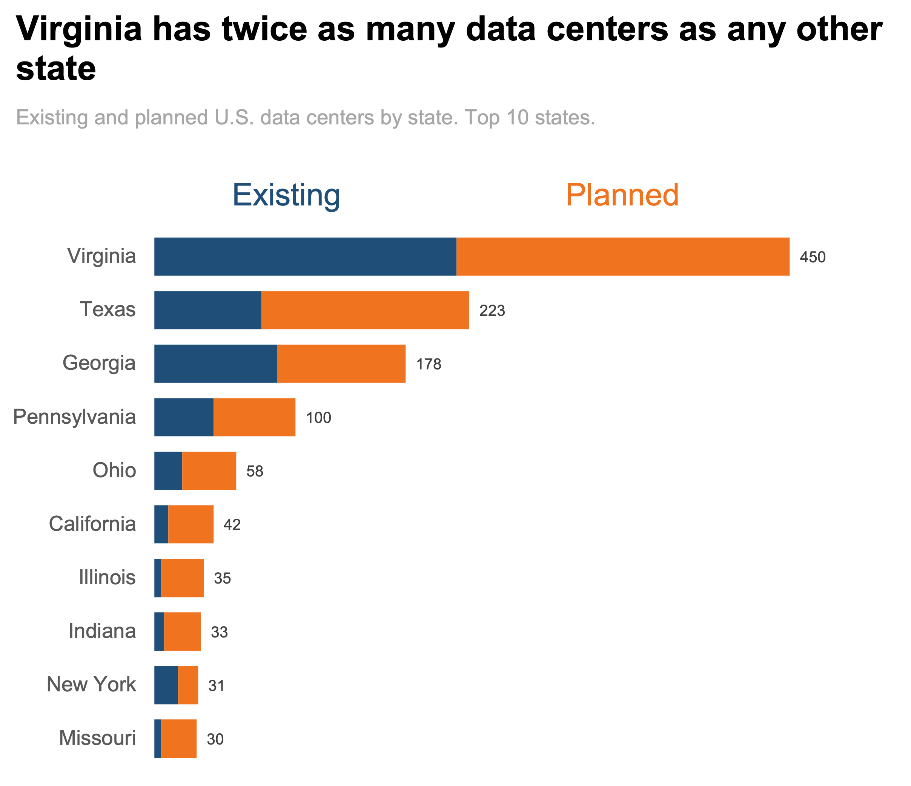
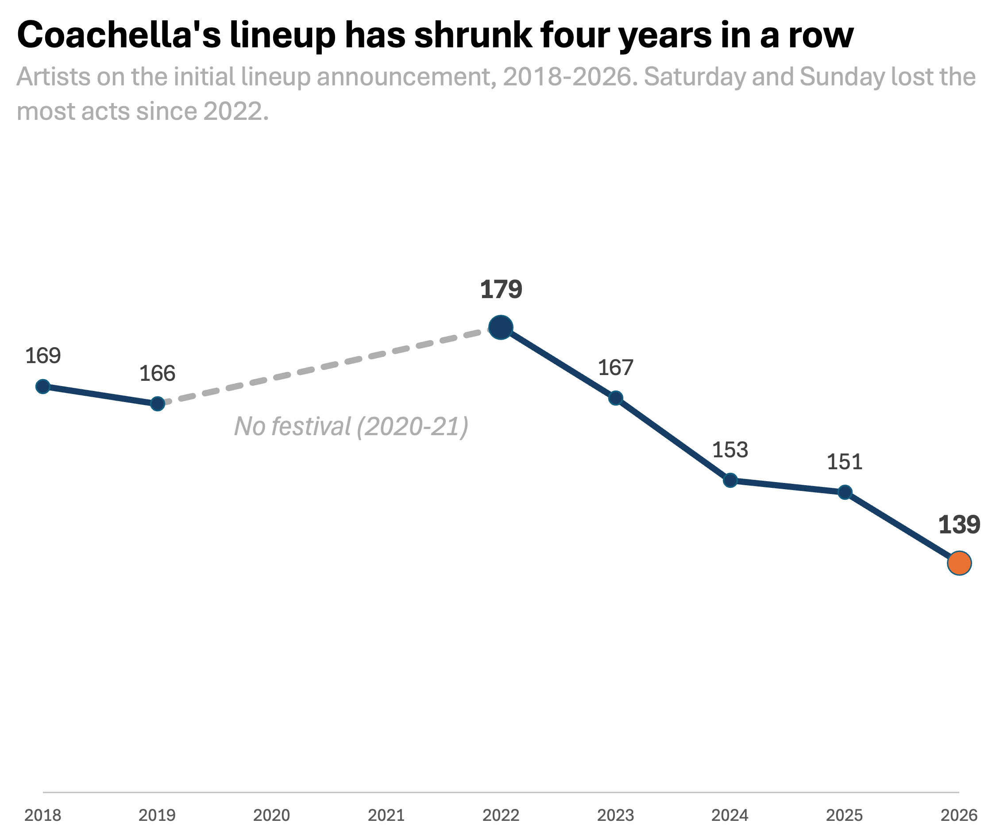

# Makeover Monday Redesigns

## 1. U.S. Data Center Locations

**Original chart:** [US Data Center Locations (Makeover Monday)](https://makeovermonday.vercel.app/dataset/us-data-center-locations)

**My redesign:**

[Link to image file](Data Centers.png)

### What I changed and why

- **Changed the map to a ranked bar chart.** On the original map, the scattered dots make it slow to tell which states have the most data centers. A bar chart lets you see the ranking at a glance.
- **Showed only the top 10 states.** The map tried to show everywhere at once. Ten bars keep the focus on where most data centers are.
- **Split each bar into "Existing" and "Planned."** The original doesn't show whether a data center is already built or still coming. This adds that distinction and shows how much more is on the way.

---

## 2. Coachella Lineup

**Original chart:** [Coachella Lineup (Makeover Monday)](https://makeovermonday.vercel.app/dataset/test-week)

**My redesign:**

[Link to image file](Coachella.png)

### What I changed and why

- **Changed the bar chart to a line chart.** The original had 28 bars across four colors, so the decline was hard to see. A line chart shows change over time more clearly.
- **Kept only the total.** The Friday, Saturday and Sunday bars made the chart crowded.
- **Highlighted the 2022 peak and the 2026 low to show the size of the drop.**
- **Showed the missing years with a dashed line.** The original skipped 2020 and 2021 as if nothing was missing.
